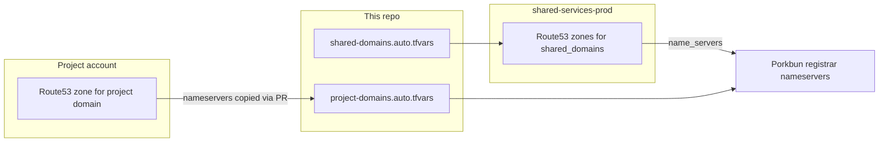

# dns-configuration

Runs in the **`shared-services-prod`** AWS account and is the single place that sets nameservers at Porkbun for every domain. Each domain's Route53 zone lives in exactly one account:

- **Shared services domains** ([`shared-domains.auto.tfvars`](infrastructure/terraform/shared-domains.auto.tfvars)): this repo creates the Route53 zone in shared services, manages its static records, and points Porkbun at it.
- **Project domains** ([`project-domains.auto.tfvars`](infrastructure/terraform/project-domains.auto.tfvars)): the project creates its own zone in its own account. Its nameservers are added here, and this repo points Porkbun at them.



Prefer shared services for every registered domain: its zone is never recreated, so Porkbun's nameservers never change and project accounts can come and go. Projects then go live by PR here:

- **A project serving the apex** (or `www`) gets records in the shared zone: alias records to its CloudFront distribution or ALB, and its ACM certificate's validation CNAMEs. Aliases work across accounts. See `virtualmadden.dev` in [`shared-records.auto.tfvars`](infrastructure/terraform/shared-records.auto.tfvars).
- **A project serving a subdomain** creates that subdomain's zone in its own account and gets NS records for it in the shared zone.

`project_domains` is for a project that must own the whole zone itself.

The account, its Terraform state bucket (`tfstate-908209634721-us-west-2`), and the `github-deploy` role CI assumes all come from [aws-organization](https://github.com/virtualmadden/aws-organization).

## Adding a shared services domain

1. Add the domain to `shared_domains` in [`shared-domains.auto.tfvars`](infrastructure/terraform/shared-domains.auto.tfvars).
2. The zone publishes records refusing all mail (null MX, `v=spf1 -all`, DMARC `p=reject`), so nobody can send mail that passes as the domain. If it should handle mail, add it to `mail_domains` and give it its own MX and SPF records.
3. Add its records to [`shared-records.auto.tfvars`](infrastructure/terraform/shared-records.auto.tfvars) (format: [`shared-records.tfvars.example`](infrastructure/terraform/shared-records.tfvars.example)). A record sets either `records` or `alias`.
4. Enable **API Access** for the domain at Porkbun.
5. Merge. The deploy workflow creates the zone and its records, then sets the domain's Porkbun nameservers.

## Adding a project domain

1. In the project account, create the zone (for example `aws_route53_zone` in the project's Terraform) and read its nameservers:

   ```bash
   aws route53 get-hosted-zone --id ZONE_ID --query 'DelegationSet.NameServers'
   ```

2. Open a PR here adding the domain to [`project-domains.auto.tfvars`](infrastructure/terraform/project-domains.auto.tfvars). Trailing dots are stripped automatically.
3. Enable **API Access** for the domain at Porkbun.
4. Merge. The deploy workflow sets the domain's Porkbun nameservers.

If a project recreates its zone, Route53 assigns new nameservers, so the entry here must be updated or the domain stops resolving.

A domain can't be in both `shared_domains` and `project_domains`; plan fails if it is.

## AWS cost

| Resource | Typical cost |
|----------|--------------|
| Route53 hosted zone (shared services) | **$0.50/month per domain in `shared_domains`** |
| Route53 hosted zone (project) | $0.50/month, billed to the project account |
| Route53 DNS queries | ~$0 for low traffic ($0.40 per million) |
| S3 state file + lock file | **~$0** |

Project domains cost shared services nothing; only the zones in `shared_domains` do.

## Prerequisites

### Porkbun

1. Create API keys: Account → API Access → Create API Key.
2. For **each domain** in `shared_domains` and `project_domains`: Domain Management → Details → enable **API Access**.

### GitHub

Repository secrets:

| Name | Description |
|------|-------------|
| `PORKBUN_API_KEY` | Porkbun API key (`pk1_...`) |
| `PORKBUN_SECRET_KEY` | Porkbun secret key (`sk1_...`) |

## GitHub Actions

- **Pull request**: fmt and validate, then `terraform plan -lock=false` with the read-only `github-plan` role, shown in the run summary. Forked and Dependabot PRs get no AWS token or Porkbun keys, so they only fmt and validate.
- **Push to `main`**: `terraform plan` then `terraform apply` with `github-deploy`, which trusts only this repo's `main` branch.

Both roles come from aws-organization's account baseline for `shared-services-prod`.

## Local usage

Sign in with SSO and use the `shared-services-prod` profile:

```bash
aws sso login
export AWS_PROFILE=shared-services-prod
export PORKBUN_API_KEY="pk1_..."
export PORKBUN_SECRET_KEY="sk1_..."

cd infrastructure/terraform
terraform init
terraform plan
```

## Verify delegation

After apply and propagation (up to 48 hours for NS changes):

```bash
dig NS example.com +short
aws route53 list-resource-record-sets --hosted-zone-id ZONE_ID
```

Nameservers from `dig` should match `terraform output shared_zones` or `terraform output project_domains`.

## Import existing Route53 zones

If a zone already exists in `shared-services-prod`:

```bash
terraform import 'module.zone["example.com"].aws_route53_zone.this' ZONE_ID
```

Import existing records individually, then run `terraform plan` to align Porkbun nameservers.

## Destroy notes

Destroying a zone removes Route53 delegation. Re-point Porkbun nameservers manually if you need the domain to keep resolving.
